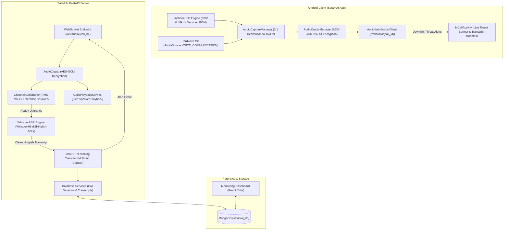
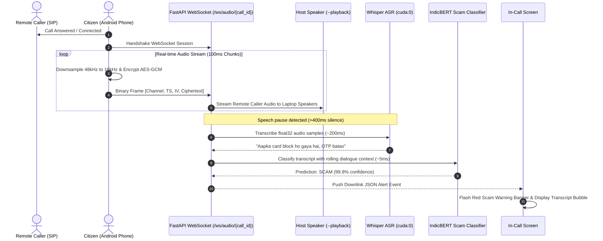

# SatarkAI (सतर्क AI)

[](https://opensource.org/licenses/MIT)
[](https://www.python.org/)
[](https://fastapi.tiangolo.com/)
[](https://huggingface.co/Oriserve/Whisper-Hindi2Hinglish-Apex)
[](https://huggingface.co/suyog17/indica-vishing-model)
[](https://developer.android.com)

**SatarkAI** is an end-to-end, real-time AI security platform designed to detect and prevent voice phishing (**vishing**) scams during live phone calls. 

It combines native Android telephony (Linphone SIP), hardware-accelerated end-to-end encrypted audio streaming (AES-GCM), GPU-accelerated Hinglish speech recognition (Whisper), context-aware NLP threat classification (IndicBERT), and a real-time forensics dashboard.

---

## ⚡ Key Highlights

- **Real-Time Encrypted Streaming**: Audio frames (100ms chunks) captured from phone calls are hardware-encrypted with **AES-GCM (256-bit)** before streaming over bi-directional WebSockets.
- **Bilingual Hinglish Telephony ASR**: Powered by `Oriserve/Whisper-Hindi2Hinglish-Apex`, optimized for Indian accents, noisy telephone codecs, and mixed Hindi-English speech with **sub-250ms latency** on NVIDIA GPUs.
- **Context-Aware Scam Detection**: Utilizes `suyog17/indica-vishing-model` (IndicBERT) evaluated over a rolling conversational dialogue history to accurately detect urgency, banking fraud, and credential extraction cues.
- **Clean Audio Pipeline**: Automatic 3:1 integer decimation (48,000 Hz $\rightarrow$ 16,000 Hz), hardware echo cancellation via `AudioSource.VOICE_COMMUNICATION`, and zero-repeat streaming guards.
- **Live In-Call Warnings**: Dynamic call screen heads-up display alerting users with instant **SCAM DETECTED** banners, threat confidence scores, and real-time live transcript bubbles.
- **Developer & Forensics Tools**: Selective CLI flags for host speaker playback (`--playback`), minimal transcript logging (`--transcript`), fraud output (`--fraud`), and an interactive React web dashboard.

---

## 🏗️ System Architecture



---

## 🔄 Live Call Processing Flow



---

## 📁 Project Structure

```text
SatarkAI/
├── backend/                       # Python FastAPI Backend & AI Services
│   ├── audio_crypto.py            # AES-GCM 256-bit audio encryption & decryption
│   ├── audio_playback.py          # Host speaker playback engine (aplay / pw-play)
│   ├── whisper_service.py         # Whisper ASR model loader, VAD buffer & deduplication
│   ├── server.py                  # Core FastAPI server, WebSockets & REST APIs
│   ├── database.py                # MongoDB connection & indexes
│   ├── db_services.py             # Database CRUD for calls, transcripts, contacts
│   ├── auth_services.py           # JWT authentication & investigator access
│   ├── requirements.txt           # Python package dependencies
│   └── test_whisper_pipeline.py   # Benchmark test script for Whisper & IndicBERT
│
├── android_app/                   # Android Native Client Application (Kotlin)
│   ├── app/src/main/java/com/satarkai/
│   │   ├── AudioCaptureManager.kt # 48kHz Linphone recording decimation & mic capture
│   │   ├── AudioCryptoManager.kt  # Android KeyStore & AES-GCM frame encryptor
│   │   ├── AudioWebSocketClient.kt# Bi-directional WebSocket streaming client
│   │   ├── LinphoneManager.kt     # SIP VoIP call management (Linphone SDK)
│   │   ├── InCallActivity.kt      # Dynamic call UI with real-time scam threat cards
│   │   ├── ServerConfigManager.kt # Dynamic server IP/port discovery
│   │   └── MainActivity.kt        # Dialer, contact list, and call history
│   └── build.gradle               # Android Gradle configuration
│
├── monitoring_dashboard/          # Cyber Investigator Forensics Dashboard (React)
│   ├── src/                       # React components, threat visualizers & logs
│   ├── package.json               # Node.js dependencies
│   └── vite.config.js             # Vite frontend build configuration
│
├── docker-compose.yml             # MongoDB container definition
├── .env.example                   # Environment configuration template
└── README.md                      # Project documentation
```

---

## 🚀 Quickstart Guide

### 1. Prerequisites

- **OS**: Linux (Ubuntu 22.04+ recommended) or macOS / Windows with WSL2
- **Python**: 3.10 or 3.11
- **Docker**: For MongoDB (`docker` and `docker compose`)
- **Android SDK**: Android Studio with Android SDK 26+ (for building the app)
- **GPU (Recommended)**: NVIDIA GPU with CUDA 12+ (Fallback to INT8 CPU supported)

---

### 2. Start MongoDB

Run the local MongoDB container:

```bash
docker compose up -d
```

Verify it is running on port `27017`:

```bash
docker compose ps
```

---

### 3. Backend Setup

1. **Navigate to the backend directory and create a virtual environment**:

   ```bash
   cd backend
   python3 -m venv .venv
   source .venv/bin/activate
   ```

2. **Install dependencies**:

   ```bash
   pip install --upgrade pip
   pip install -r requirements.txt
   ```

3. **Configure Environment Variables**:

   Copy the example environment configuration:

   ```bash
   cp ../.env.example .env
   ```

---

### 4. Run the Backend Server

Start the backend using **Uvicorn** or directly via **Python**. Use the built-in CLI flags to enable the features you need:

#### Option A: Run Everything (Playback + Transcript + Fraud Logs)

```bash
# Using uvicorn:
backend/.venv/bin/uvicorn backend.server:app --host 0.0.0.0 --port 8000 --all

# Or directly with Python:
backend/.venv/bin/python backend/server.py --all
```

#### Option B: Granular Flags

| Flag | Description |
| :--- | :--- |
| `--all` / `-a` | Enables all outputs: real-time speaker playback, transcript logs, and fraud logs |
| `--playback` | Plays incoming remote caller audio in real-time through host speakers |
| `--transcript` | Logs single-line real-time Hinglish transcripts with latency timings |
| `--fraud` | Logs IndicBERT scam classification predictions and confidence scores |
| `--host <ip>` | Server bind host (default: `0.0.0.0`) |
| `--port <port>`| Server port (default: `8000`) |

Example:

```bash
backend/.venv/bin/python backend/server.py --playback --transcript --fraud
```

Expected startup console banner:

```text
========================================================================
  🚀 SatarkAI Call Intelligence Server [Device: cuda]
  🔊 Playback   : ENABLED (--playback)
  🎙️ Transcript : ENABLED (--transcript)
  🤖 Fraud Logs : ENABLED (--fraud)
========================================================================
```

---

### 5. Build & Run the Web Dashboard (Optional)

The React investigation dashboard allows viewing active calls, transcript forensics, and fraud analysis:

```bash
cd monitoring_dashboard
npm install
npm run build
```

Once built, the dashboard is automatically served by the FastAPI backend at:
`http://localhost:8000/`

For standalone frontend development:

```bash
npm run dev
```

---

### 6. Build & Install Android App

1. Ensure your Android device has **USB Debugging** enabled and is connected:

   ```bash
   adb devices
   ```

2. Configure your server IP:
   Open the app, go to **Settings** (or edit `ServerConfigManager.kt`), and point the server URL to your machine's local IP (e.g., `http://192.168.1.100:8000`).

3. **Build and install the Debug APK**:

   ```bash
   cd android_app
   ./gradlew assembleDebug
   adb install -r app/build/outputs/apk/debug/app-debug.apk
   ```

---

## 📊 Live Output Preview

When a call is active and someone is speaking, the backend prints clean, single-line logs:

```text
🎙️ [TRANSCRIPT] [REMOTE] "Hello, main bank verification department se bol raha hoon." (198ms)
🚨 [FRAUD] SCAM (99.8%) [Safe: 0.2% | Scam: 99.8%] (5ms)
🎙️ [TRANSCRIPT] [REMOTE] "Aapka debit card block ho gaya hai, turant 6-digit OTP share karein." (205ms)
🚨 [FRAUD] SCAM (99.9%) [Safe: 0.1% | Scam: 99.9%] (5ms)
```

At the exact same time, the citizen's phone displays:
- A high-visibility **red alert card** (`SCAM DETECTED - Threat Confidence: 99%`).
- An explanatory cue badge (`High urgency & credential extraction cues identified`).
- A live transcript chat bubble in the expandable transcript viewer.

---

## 🛠️ Testing & Verification

You can verify the ASR and NLP pipeline directly without an active call using the built-in test suite:

```bash
backend/.venv/bin/python backend/test_whisper_pipeline.py
```

This runs synthetic PCM audio and benchmark audio through:
- AES-GCM frame decryption
- Whisper Hinglish speech recognition
- IndicBERT context-aware vishing detection

---

## 🔒 Security & Privacy

- **No Plaintext Audio Storage**: Audio chunks are processed in-memory in rolling 100ms buffers and immediately freed after transcription.
- **End-to-End Encryption**: Android clients derive session keys via SHA-256 and encrypt all audio frames with **AES-GCM** before sending them across the wire.
- **Acoustic Echo Cancellation**: Phone capture uses Android's native hardware `AudioSource.VOICE_COMMUNICATION` subsystem to prevent speaker-to-mic feedback loops.

---

## 📄 License

This project is licensed under the [MIT License](LICENSE).
