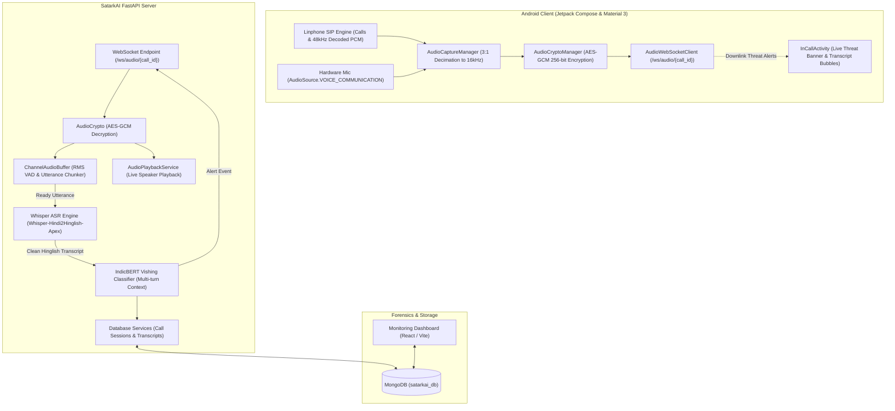
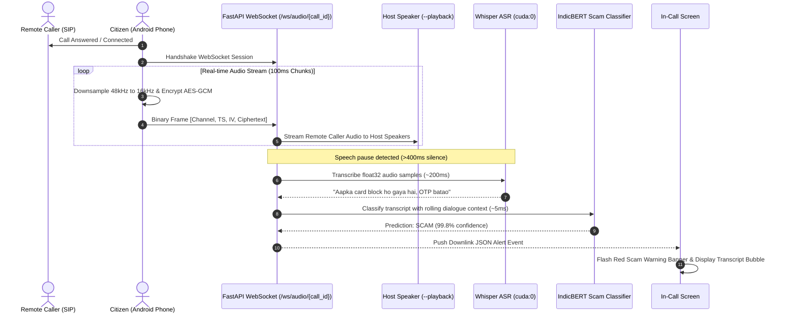

# SatarkAI (सतर्क AI)

<p align="center">
  
</p>

[](https://opensource.org/licenses/MIT)
[](https://www.python.org/)
[](https://fastapi.tiangolo.com/)
[](https://huggingface.co/Oriserve/Whisper-Hindi2Hinglish-Apex)
[](https://huggingface.co/suyog17/indica-vishing-model)
[](https://developer.android.com)

**SatarkAI** is an end-to-end, real-time AI security platform engineered to detect and prevent voice phishing (**vishing**) scams during live telephone conversations.

The system pairs a modern **Android application built with Jetpack Compose & Material 3** (Linphone SIP VoIP, AES-GCM 256-bit hardware-accelerated encryption) with a **high-throughput FastAPI inference server** (GPU-accelerated bilingual Hinglish Whisper ASR, context-aware IndicBERT classification) and a **React-based Cyber Forensics Investigation Dashboard**.

---

## Key Highlights

- **Real-Time Encrypted Telephony**: 100ms PCM audio frames captured from SIP phone calls are encrypted on-device via **AES-GCM (256-bit)** using hardware-backed keystores before streaming over bi-directional WebSockets.
- **Bilingual Hinglish Telephony ASR**: Powered by `Oriserve/Whisper-Hindi2Hinglish-Apex`, tailored for Indian accents, noisy telephone codecs, and mixed Hindi-English speech with **sub-250ms latency** on NVIDIA GPUs (with INT8 CPU fallback).
- **Context-Aware Scam Detection**: Employs `suyog17/indica-vishing-model` (IndicBERT) evaluated over a rolling conversational dialogue history to accurately detect urgency, banking coercion, and credential extraction.
- **Clean Audio Pipeline**: Automatic 3:1 integer decimation (48,000 Hz to 16,000 Hz), hardware acoustic echo cancellation via `AudioSource.VOICE_COMMUNICATION`, and zero-repeat streaming guards.
- **Pixel-Native Android App**: Entirely migrated to **Jetpack Compose** with **Material 3**, Monet dynamic theming on Android 12+, clean brand fallbacks for Android 11 and lower, dark/light theme switching, and live heads-up in-call threat warnings.
- **Forensics Investigation Dashboard**: Modern Material 3-styled web application deployed with automated GitHub Pages workflows (`satarkai.me`), complete with live server health diagnostics and dynamic FastAPI endpoint switching.

---

## System Architecture



---

## Live Call Processing Flow



---

## Project Structure

```text
SatarkAI/
├── logo.png                       # Official project brand logo
├── docker-compose.yml             # MongoDB local container definition
├── .env.example                   # Environment configuration template
│
├── backend/                       # Python FastAPI Backend & AI Services
│   ├── audio_crypto.py            # AES-GCM 256-bit audio encryption & decryption
│   ├── audio_playback.py          # Host speaker playback engine (aplay / pw-play)
│   ├── whisper_service.py         # Whisper ASR model loader, VAD buffer & deduplication
│   ├── server.py                  # Core FastAPI server, WebSockets & REST APIs
│   ├── database.py                # MongoDB connection & collection handlers
│   ├── db_services.py             # Database CRUD for calls, transcripts, contacts
│   ├── auth_services.py           # JWT authentication & officer access clearance
│   ├── start_tunnel.sh            # Universal tunnel script (Cloudflare / Localtunnel)
│   ├── requirements.txt           # Python package dependencies
│   ├── test_whisper_pipeline.py   # Benchmark test script for Whisper & IndicBERT
│   ├── test_api_endpoints.py      # REST & health endpoint unit tests
│   ├── test_investigation_endpoints.py # Forensics & investigation API tests
│   └── test_mongo.py              # MongoDB integration test suite
│
├── android_app/                   # Android Native Client Application (Kotlin)
│   ├── app/src/main/java/com/satarkai/
│   │   ├── MainActivity.kt        # Jetpack Compose UI (Contacts, Recents, Keypad, SIP)
│   │   ├── InCallActivity.kt      # Dynamic call UI with real-time scam threat cards
│   │   ├── AudioCaptureManager.kt # 48kHz Linphone recording decimation & mic capture
│   │   ├── AudioCryptoManager.kt  # Android KeyStore & AES-GCM frame encryptor
│   │   ├── AudioWebSocketClient.kt# Bi-directional WebSocket streaming client
│   │   ├── LinphoneManager.kt     # SIP VoIP call management (Linphone SDK)
│   │   ├── ServerConfigManager.kt # Dynamic server IP/port discovery & health checks
│   │   ├── theme/                 # Material 3 theme & dynamic Monet color palettes
│   │   └── ui/                    # MainScreen Compose tabs & components
│   └── build.gradle               # Android Gradle configuration
│
├── monitoring_dashboard/          # Cyber Investigator Forensics Dashboard (React / Vite)
│   ├── src/                       # React components, threat visualizers & M3 design
│   ├── package.json               # Node.js dependencies
│   ├── vite.config.js             # Vite frontend build configuration
│   └── public/                    # Static assets & CNAME
│
└── .github/workflows/             # CI/CD Workflows
    └── deploy-dashboard.yml       # Automated GitHub Pages deployment to satarkai.me
```

---

## Quickstart Guide

Follow these simple steps to get the full stack up and running from a fresh clone.

### 1. Clone the Repository

```bash
git clone https://github.com/pradness/SatarkAI.git
cd SatarkAI
```

---

### 2. Configure Environment

Copy the example environment configuration to `.env`:

```bash
cp .env.example .env
```

If using a local MongoDB instance, the default `MONGODB_URI=mongodb://127.0.0.1:27017/satarkai_db` works out of the box. If using MongoDB Atlas, update the connection URI in `.env`.

---

### 3. Start MongoDB (Optional if using MongoDB Atlas)

Start the local MongoDB service using Docker Compose:

```bash
docker compose up -d
```

Verify that MongoDB is running:

```bash
docker compose ps
```

---

### 4. Setup & Run the Backend Server

1. **Create and activate a virtual environment**:

   ```bash
   python3 -m venv backend/.venv
   source backend/.venv/bin/activate
   ```

2. **Install Python dependencies**:

   ```bash
   pip install --upgrade pip
   pip install -r backend/requirements.txt
   ```

3. **Start the FastAPI Server**:

   You can start the server with desired runtime flags:

   ```bash
   # Run with all live debugging outputs enabled (audio playback, transcripts, fraud scores):
   python backend/server.py --all

   # Or specify granular flags:
   python backend/server.py --transcript --fraud --playback
   ```

   **Available CLI Flags**:

   | Flag | Description |
   | :--- | :--- |
   | `--all` / `-a` | Enables all outputs: real-time speaker playback, transcript logs, and fraud logs |
   | `--playback` | Plays incoming remote caller audio in real-time through host speakers |
   | `--transcript` | Logs single-line real-time Hinglish transcripts with latency timings |
   | `--fraud` | Logs IndicBERT scam classification predictions and confidence scores |
   | `--host <ip>` | Server bind host (default: `0.0.0.0`) |
   | `--port <port>` | Server port (default: `8000`) |

   **Interactive Documentation**:
   - Swagger UI: `http://127.0.0.1:8000/docs`
   - ReDoc: `http://127.0.0.1:8000/redoc`
   - Health Check: `http://127.0.0.1:8000/health`

---

### 5. Run the Cyber Forensics Dashboard

The frontend dashboard can be run locally or accessed via `https://satarkai.me`.

1. **Install dependencies and run in development mode**:

   ```bash
   cd monitoring_dashboard
   npm install
   npm run dev
   ```

2. **Or build for production**:

   ```bash
   npm run build
   ```

   When built, the production files in `monitoring_dashboard/dist` are automatically hosted directly by the FastAPI backend at `http://127.0.0.1:8000/dashboard/`.

---

### 6. Build & Run the Android Application

1. Connect your Android device via USB with **USB Debugging** enabled:

   ```bash
   adb devices
   ```

2. Build and install the debug APK:

   ```bash
   cd android_app
   ./gradlew assembleDebug
   adb install -r app/build/outputs/apk/debug/app-debug.apk
   ```

3. Launch the app on your phone:
   - On the **SIP Line** tab, register a SIP account (e.g., via `sip.linphone.org` or your PBX).
   - Enter your backend URL (e.g., `http://<YOUR_LOCAL_IP>:8000` or `https://api.satarkai.me`) and tap **Save**.
   - Use the **Keypad** or **Contacts** tab to initiate a monitored call.

---

### 7. Run Across Public Networks (Cloudflare Tunnel)

To connect an Android phone over 4G/5G mobile data to your local backend without port forwarding:

```bash
./backend/start_tunnel.sh
```

Or run your named Cloudflare tunnel:

```bash
cloudflared tunnel run satarkai-backend
```

Point your Android app and dashboard to `https://api.satarkai.me`.

---

## Live Output Preview

When a call is active and dialogue occurs, the backend outputs formatted, single-line logs:

```text
[TRANSCRIPT] [REMOTE] "Hello, main bank verification department se bol raha hoon." (198ms)
[FRAUD] SCAM (99.8%) [Safe: 0.2% | Scam: 99.8%] (5ms)
[TRANSCRIPT] [REMOTE] "Aapka debit card block ho gaya hai, turant 6-digit OTP share karein." (205ms)
[FRAUD] SCAM (99.9%) [Safe: 0.1% | Scam: 99.9%] (5ms)
```

Simultaneously, the Android app screen displays:
- A high-contrast **SCAM DETECTED** warning banner with threat percentage.
- Real-time WhatsApp-style transcript bubbles for both caller and receiver.
- Identified threat factors (urgency, credential solicitation, coercion).

---

## Testing & Verification

Run the automated test suite to verify ASR, NLP classification, and API routes:

```bash
# Test Whisper ASR & IndicBERT inference pipeline:
python backend/test_whisper_pipeline.py

# Test REST API endpoints:
python -m unittest backend/test_api_endpoints.py

# Test investigation & forensics endpoints:
python -m unittest backend/test_investigation_endpoints.py
```

---

## Security & Privacy

- **Zero Plaintext Audio Persistence**: Raw audio chunks are processed in-memory in rolling 100ms buffers and immediately freed after transcription.
- **Hardware-Backed AES-GCM**: Cryptographic keys are stored in the Android KeyStore, and frames are encrypted prior to network transmission.
- **Statutory Transcript Privacy**: Legitimate citizen calls that are neither flagged by ML models nor reported by users are excluded from audio transcript inspection.
- **Acoustic Echo Cancellation**: Utilizes hardware `AudioSource.VOICE_COMMUNICATION` to prevent speaker-to-mic feedback loops.

---

## License

This project is licensed under the [MIT License](LICENSE).
